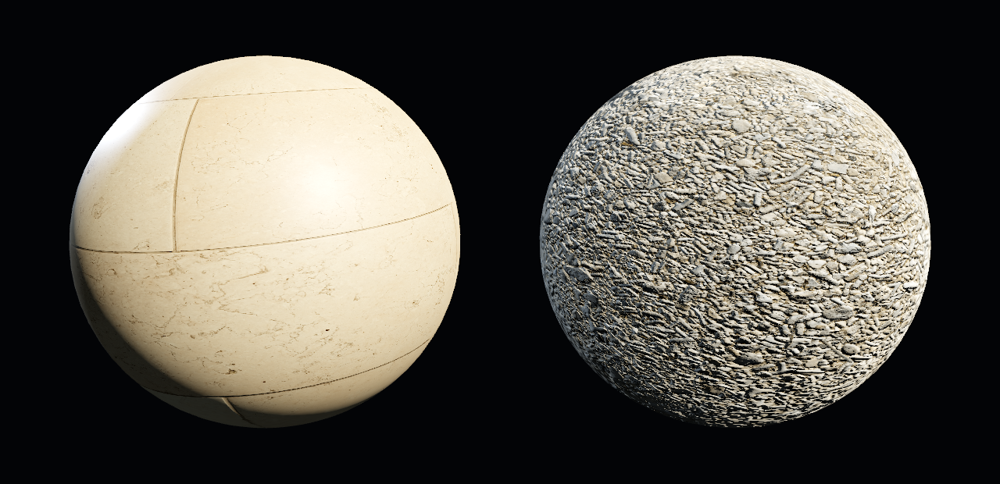

# Voivent Neural Material (VNM1) for Godot 4.7+

Runtime loader and GPU fragment-shader decoder addon for **Voivent Neural Material (VNM1)** PBR materials in Godot `4.7.2` (4.7 series) across **Forward+**, **Mobile**, and **Compatibility** renderers.

- **Live WebGPU Demo**: **[https://daw.voivent.com/lab/vnm/](https://daw.voivent.com/lab/vnm/)**
- **TypeScript / WebGPU Runtime & SPEC**: [`cdismus4/voivent-neural-material`](https://github.com/cdismus4/voivent-neural-material)


*Rendered directly in Godot `4.7.2-stable` (Forward+): Left = `Marble 01` (`standard` 4ch, `1.26 MB`), Right = `Coast Sand 03` (`quality8` 8ch, `10.01 MB`). Source textures: Poly Haven (CC0-1.0).*

## Features

- **Zero GDExtension required**: Pure GDScript + Godot spatial shading language (`addons/voivent_neural_material/`).
- **All 5 VNM1 profiles supported** from a single parameterized template: `small` (4ch), `standard` (4ch), `quality` (4ch), `standard8` (8ch), and `quality8` (8ch).
- **Weights as `RGBA32F` texture (`texelFetch`)**: Bypasses uniform vector size limits cleanly across Forward+, Mobile, and Compatibility.
- **Two sampling paths**:
  - `HARDWARE_BILINEAR` (Path A, default runtime): Hardware `textureLod` filtering, passing `SPEC §7.2` (`<= 1e-4` lattice, `<= 2.0e-4` arbitrary UV).
  - `EXACT_BILINEAR` (Path B, strict conformance): `texelFetch` x 4 manual `SPEC §6.1` bilinear interpolation with exact `repeat` / `clamp` wrapping (`<= 1e-4` gate).
- **Runtime `.vnm` folder and `.zip` loader**: Reads 4-file VNM1 bundles (`manifest.json`, `weights.bin`, `level-0.bin`, `tail.bin`) with strict SHA-256, header magic/version, subheader dimension, and reserved-byte validation without going through editor image import.
- **Progressive `tail` transition & `normalizedMip` override**: Includes `use_normalized_mip_override` / `normalized_mip_override` for golden verification and distance-based switching to split `tail` textures.

## Installation

1. Copy `addons/voivent_neural_material/` into your Godot 4.7+ project's `addons/` folder.
2. Enable **Voivent Neural Material (VNM1)** under **Project -> Project Settings -> Plugins**.

> **Exporting Builds (`.pck`)**: Because `VnmLoader` reads `.json` and `.bin` (or `.zip`) files directly via `FileAccess` without editor import, add `*.json, *.bin` (or `*.zip`) to **Project -> Export -> Resources -> Filters to export non-resource files/folders** if you bundle `.vnm` assets inside `res://` — or load them from `user://` / an external directory.

## Quickstart

```gdscript
extends Node3D

func _ready() -> void:
	var mesh_instance := $MeshInstance3D
	var result := VnmMaterial.apply_to_mesh(mesh_instance, "res://materials/marble.vnm")
	if not result.get("ok", false):
		push_error("Failed to load VNM1 material: %s" % result.get("error", ""))
```

For strict mathematical `EXACT_BILINEAR` sampling or verification `normalizedMip` overrides:

```gdscript
var res := VnmMaterial.load_from_path(
	"res://materials/marble.vnm",
	VnmShaderGenerator.SamplingPath.EXACT_BILINEAR
)
var vnm_mat: VnmMaterial = res["vnm_material"]
vnm_mat.bind_to_mesh($MeshInstance3D)
vnm_mat.set_normalized_mip_override(true, 0.5)
```

## Verification & Re-running SPEC §7 Conformance Tests

> **Important**: Godot's `--headless` flag uses the dummy renderer and returns empty pixels. Always run GPU verification against a real window/virtual display driver (e.g. `xvfb-run` + `--rendering-driver vulkan` on Linux CI, or `--rendering-driver metal` / `vulkan` on macOS).

### 1. Loader & Strict Rejection Suite (`G-1`)
```bash
godot --path . res://tests/test_g1_loader.tscn --rendering-driver metal --resolution 128x128 --quit-after 300
```

### 2. Golden Vector `SPEC §7` Two-Tier Conformance Suite (`G-4`)
Tests all 4 profiles (`standard`, `standard8`, `quality`, `quality8` x 286 cases) across Path B float, Path B u8, Path A hardware bilinear, plus a negative control (deterministically shuffled latent bytes that must fail the gate). Set `VNM_GOLDEN_DIR` to the directory containing the golden vector JSON files (`golden_vectors*.json`):
```bash
VNM_GOLDEN_DIR=/path/to/vnm1-golden-vectors \
  godot --path . res://tests/test_g4_golden_harness.tscn --rendering-driver metal --resolution 128x128 --quit-after 600
```
Outputs JSON report to `tests/reports/godot_g4_report.json`.

### 3. Real CC0 Demo Assets End-to-End Suite (`G-5`)
Tests all 4 demo assets (`marble`, `fabric030`, `sand`, `cloth`) across Forward+, Mobile, and Compatibility renderers. Set `VNM_DEMO_ASSETS_DIR` to your directory containing the `.vnm` material folders:
```bash
VNM_DEMO_ASSETS_DIR=/path/to/vnm-demo-assets \
  godot --path . res://tests/test_g5_demo_assets.tscn --rendering-driver metal --resolution 128x128 --quit-after 5000
```

### 4. P2-Aligned GPU / Frame Cost Benchmark
Measures `gpu_ms` and frame delta against a 3-texture `1024x1024` `StandardMaterial3D` PBR baseline at `1280x720` (`60` warmup + `300` measured frames, `25%` / `50%` / `100%` screen coverage). Use `--rendering-driver vulkan` so `RenderingServer.viewport_get_measured_render_time_gpu()` records hardware GPU timestamps:
```bash
VNM_DEMO_ASSETS_DIR=/path/to/vnm-demo-assets \
  godot --path . res://tests/test_p2_cost_benchmark.tscn --rendering-driver vulkan --rendering-method forward_plus --resolution 1280x720 --disable-vsync --max-fps 0
```
Outputs JSON report to `tests/reports/godot_p2_cost_<rendering_method>.json`.

## Sample Scene

Open `demo/sample_scene.tscn` or pass any `.vnm` directory or `.zip` bundle via CLI (`--vnm=...`) or `VNM_SAMPLE_PATH`:
```bash
godot --path . res://demo/sample_scene.tscn -- --vnm=/path/to/marble.vnm
```

## Known Limitations (VNM1 v1)

- **No intermediate mipmaps in v1**: VNM1 v1 assets encode mip 0 (`level-0.bin`) plus a `16x16` `tail.bin` without intermediate mip levels (mip 1..6). High-frequency woven/periodic surfaces (e.g. denim or fine fabric) will exhibit minification moire at steep distances compared to mipmapped PBR textures.
- **Channel scope**: 8 PBR channels (`baseColor` RGB, tangent `normal` XY with `+Y` up, `roughness`, `metalness`, `ao`); alpha cutout, emissive, and height maps are outside v1.

## License

Licensed under the [Apache License, Version 2.0](./LICENSE).
